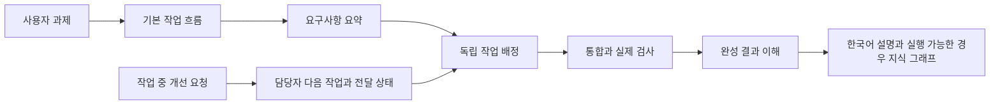

# 이 스킬팩을 이해하기

TaskFlow는 AI가 일을 진행할 때 따르는 지침과, 그 진행 상태를 기록하는 로컬 도구의 묶음이다. 결과물의 기능을 대신 구현하는 완성 앱은 아니다.

이 문서는 실제 구현 소스에 근거한 구조 설명이다. Understand Anything 원본의 전체 분석 파이프라인과 대시보드를 실행해서 만든 그래프는 아니다.

## 전체 흐름

## 무엇이 어디에 있는가

| 위치 | 하는 일 |
|---|---|
| [skills](../skills) | AI가 과제 해석·작업 분할·개선 요청·검증·결과 설명을 판단할 때 읽는 지침 |
| [kit.py](../kit.py) | 설치·작업판·검사·Understand Anything 준비 확인을 시작하는 입구 |
| [taskflow/board.py](../taskflow/board.py) | SQLite에 작업·담당자·의존성·수정 예약·요청·전달 이력을 보존 |
| [taskflow/cli.py](../taskflow/cli.py) | 작업판 명령의 입력을 읽고 처리 결과를 JSON으로 반환 |
| [taskflow/checks.py](../taskflow/checks.py) | 실제 검사 명령과 로그·종료 상태·소스 해시를 기록하고 오래된 증거를 거절 |
| [taskflow/install.py](../taskflow/install.py) | 기존 지침과 과제 파일을 보존하며 프로젝트 안에 스킬팩 배치 |
| [taskflow/understand.py](../taskflow/understand.py) | 원본 Understand Anything 위치와 준비 상태를 확인 |
| [upstream](../upstream) | 커밋·해시·라이선스를 유지한 공개 원본 |

## 개선 요청 하나가 처리되는 과정

계산 담당 A가 작업 중인데 “끝나면 CSV 내보내기도 추가해줘”라는 요청이 들어왔다고 하자.

1. 조율 담당 AI가 요청 원문과 고유 ID를 보존한다. 어떤 파일과 요구사항에 영향을 주는지 판단한다.
2. 작업판에 A의 다음 작업을 등록하고 선행 작업을 연결한다. 실제 담당이 다른 작업자라면 그 담당에게 배정한다.
3. 조율 담당이 실제 에이전트 메시지 도구를 호출한다. 로컬 작업판 자체가 메시지를 보내는 것은 아니다.
4. A가 바쁘거나 선행 작업이 아직 통합되지 않았으면 새 작업은 시작되지 않는다. 독립된 다른 작업자는 계속 진행할 수 있다.
5. 계산 작업을 실제로 통합하면 다음 작업이 준비된다. CSV 구현을 통합한 뒤 실제 출력과 원래 ID를 검사한다.
6. 최종 결과물에 Understand Anything을 적용해, 이 흐름과 중요한 파일·선택 이유·검사·한계를 한국어로 설명한다.

등록됨, 전달 도구가 수락함, 작업자가 시작함, 통합됨, 검증됨은 서로 다른 상태다. 메시지 타임아웃은 `unknown`으로 남긴다.

## 왜 이런 방식을 썼는가

- SQLite 트랜잭션으로 여러 프로세스가 동시에 작업을 예약해도 같은 수정 범위를 중복 점유하지 않게 했다.
- 파일 범위 외에 읽기/쓰기 공통 자원을 두어, 파일이 달라도 API 계약·DB·포트 같은 공유 요소의 충돌을 표현할 수 있게 했다.
- 원본 요구사항과 관찰 가능한 확인 방법을 연결해 AI의 요약과 실제 과제의 차이를 확인할 수 있게 했다.
- 최종 설명은 구현·검증 후에 만든다. 만들 예정인 설계와 실제 완성된 동작이 섞이는 것을 줄이기 위해서다.

## 검증과 한계

[검증 문서](VALIDATION.ko.md)와 [검사 로그](test-results.txt)에 실제 확인 범위를 기록한다. 수정 예약은 협력 규칙이므로 에이전트의 임의 직접 파일 수정을 OS에서 차단하지 않는다. 병렬 실행과 메시지 전달은 실제 AI 환경의 도구가 담당한다.

Understand Anything의 소스 포함·준비 상태·원본 그래프 실행·설명 완성도 각각 구분한다. 그래프 실행을 못 해도 실제 구현 근거가 있는 설명은 제공할 수 있지만, 그 설명을 원본 파이프라인 실행으로 표시하지 않는다.
