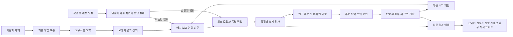

# 이 스킬팩을 이해하기

TaskFlow Kit 1.2.0은 AI가 과제를 정의하고 모델을 만들고 개선할 때 따르는 지침과, 진행 상태를 기록하는 로컬 도구의 묶음이다. 모델은 입력부터 출력까지 목적을 수행하는 전체 방식이며 AI 모델에 한정되지 않는다.

이 문서는 실제 구현 소스에 근거한 구조 설명이다. Understand Anything 원본의 전체 분석 파이프라인과 대시보드를 실행해서 만든 그래프는 아니다.

## 전체 흐름

실험은 승인된 배치에서만 진행한다. 후보 채택은 매번 별도 승인을 받고, 실패하면 보존한 현재 채택 모델로 복구한다. 새 모델의 약점을 진단해도 다음 배치를 자동 시작하지 않는다. 구체적인 판단 기준은 [공통 의사결정 정책](../skills/taskflow-workflow/references/decision-policy.md)에 있다.

## 무엇이 어디에 있는가

| 위치 | 하는 일 |
|---|---|
| [skills](../skills) | TaskFlow 7개와 `understand` 1개, 총 8개 지침. 과제 해석·모델 정의·분할·요청·개선·검증·설명을 담당 |
| [모델 정의](../skills/taskflow-model/SKILL.md) · [개선 실험](../skills/taskflow-improve/SKILL.md) | 모듈의 목적에 맞는 방법 선택과 현재 채택 모델을 보존한 제한된 후보 비교 |
| [kit.py](../kit.py) | 설치·작업판·검사·Understand Anything 준비 확인을 시작하는 입구 |
| [taskflow/board.py](../taskflow/board.py) | SQLite에 작업·담당자·의존성·수정 예약·요청·전달 이력을 보존 |
| [taskflow/cli.py](../taskflow/cli.py) | 작업판 명령의 입력을 읽고 처리 결과를 JSON으로 반환 |
| [taskflow/checks.py](../taskflow/checks.py) | 실제 검사 명령과 로그·종료 상태·소스 해시를 기록하고 오래된 증거를 거절 |
| [taskflow/install.py](../taskflow/install.py) | 기존 지침과 과제 파일을 보존하며 프로젝트 안에 스킬팩 배치 |
| [taskflow/understand.py](../taskflow/understand.py) | 원본 Understand Anything 위치와 준비 상태를 확인 |
| [upstream](../upstream) | 커밋·해시·라이선스를 유지한 공개 원본 |

과제별 `.taskflow/model-plan.md`, `.taskflow/decisions.md`, `.taskflow/accepted.md`, `.taskflow/experiments/C1.md`는 모델·실제 사용자 결정·수용 버전·실험 근거를 남기는 문서다. 명령이 자동으로 승인 상태를 만들거나 실험을 실행하는 기능과는 구분한다.

## native 에이전트 모델 계획

[모델 정책](../skills/taskflow-parallel/references/model-policy.json)에는 난이도별 기본 모델·effort와 허용 목록이 고정되어 있고, [모델 라우팅 설명](../skills/taskflow-parallel/references/model-routing.md)은 실제 native 도구 호출 절차를 정한다. 기본값은 basic Luna 6/low, standard Sol 6.1/medium, critical Sol 6.1/high다. 허용 목록은 Sol 6.1, Terra 5.6, Luna 6, Sol 6.0이며 Astra는 금지다. Terra 5.6은 현재 검증된 native ID가 없어 `null`로 남고, Terra 6.1이나 Sol 5.6으로 자동 대체하지 않는다. Sol 6.0은 명시적으로 허용된 대안이다.

`taskflow/models.py`의 `agent-plan`은 오프라인 입력 검증기다. 호출자가 관찰했다고 제공한 정확한 native ID가 정책 선택과 일치하는지 확인하고 모델·effort 계획을 출력한다. 실제 native dispatch, 승인, 부모 모델 변경, 매핑·설정 갱신을 수행하지 않으며 caller 입력 자체를 증명하지 않는다. 실제 실행 전에 native 도구의 모델·effort 지원을 확인해 값을 명시해야 한다. 선택 필드가 없는 도구에 그 기능을 추가하거나, OS 차원에서 직접 도구 호출을 차단하는 기능은 아니다. 키트·모델·스킬·upstream·의존성·전역 설정 자동 업데이트도 없다.

## 개선 요청 하나가 처리되는 과정

계산 담당 A가 작업 중인데 “끝나면 CSV 내보내기도 추가해줘”라는 요청이 들어왔다고 하자.

1. 조율 담당 AI가 요청 원문과 고유 ID를 보존하고 영향을 판단한다. CSV 추가가 승인 범위를 넓히면 먼저 사용자와 다시 논의하고 배치 승인을 받는다.
2. 승인된 다음 작업을 작업판에 등록하고 선행 작업을 연결한다. 실제 담당이 다른 작업자라면 그 담당에게 배정한다.
3. 조율 담당이 실제 에이전트 메시지 도구를 호출한다. 로컬 작업판 자체가 메시지를 보내는 것은 아니다.
4. A가 바쁘거나 선행 작업이 아직 통합되지 않았으면 새 작업은 시작되지 않는다. 독립된 다른 작업자는 계속 진행할 수 있다.
5. 계산 작업을 실제로 통합하면 다음 작업이 준비된다. CSV 구현을 통합한 뒤 실제 출력과 원래 ID를 검사한다. 실험 후보가 현재 채택 모델을 바꾸는 경우에는 별도 채택 승인과 반영 뒤 재검사를 거친다.
6. 최종 결과물에 Understand Anything을 적용해, 이 흐름과 중요한 파일·선택 이유·검사·한계를 한국어로 설명한다.

등록됨, 전달 도구가 수락함, 작업자가 시작함, 통합됨, 검증됨은 서로 다른 상태다. 메시지 타임아웃은 `unknown`으로 남긴다.

## 왜 이런 방식을 썼는가

- 입력·출력의 의미와 평가 기준을 먼저 정해, 모듈별 방법이 실제 목적을 수행하는지 비교할 수 있게 했다. 방법 교체·병렬 후보·혼합과 모듈 추가·삭제·순서 변경도 의존성을 확인하며 비교한다.
- 현재 채택 모델과 실험 후보를 분리해 검증 전 변경이 기존 결과를 대체하지 않게 했다. 공정한 비교와 독립 비평의 근거를 보고하고 사용자가 각 후보의 채택을 결정한다.
- 사실·선호·가설을 나누고 근거·반례·대안을 검토한다. 해결되지 않은 우선순위 충돌은 사용자에게 확인하며, 임의 가중치나 침묵으로 결론을 만들지 않는다.
- SQLite 트랜잭션으로 여러 프로세스가 동시에 작업을 예약해도 같은 수정 범위를 중복 점유하지 않게 했다.
- 파일 범위 외에 읽기/쓰기 공통 자원을 두어, 파일이 달라도 API 계약·DB·포트 같은 공유 요소의 충돌을 표현할 수 있게 했다.
- 원본 요구사항과 관찰 가능한 확인 방법을 연결해 AI의 요약과 실제 과제의 차이를 확인할 수 있게 했다.
- 최종 설명은 구현·검증 후에 만든다. 만들 예정인 설계와 실제 완성된 동작이 섞이는 것을 줄이기 위해서다.

## 검증과 한계

[검증 문서](VALIDATION.ko.md)와 해당 실행 로그에 실제 확인 범위를 기록한다. 기존 v1.1의 46개 검사 통과를 v1.2의 새 검증 결과로 읽으면 안 된다. 스킬 지침 추가는 자동 실험 실행기·상시 감시 서비스·OS 차원의 승인 강제 구현을 뜻하지 않는다.

수정 예약은 협력 규칙이므로 직접 파일 수정을 OS에서 차단하지 않는다. 프론트엔드·백엔드 모듈이나 경쟁 후보의 병렬 실행과 메시지 전달은 실제 AI 환경의 native 도구가 담당한다. 독립 비평자는 원문 요구와 실제 결과를 검토하지만 채택·배포를 승인할 수 없다. 도구가 없으면 순차 실행·자체 검토임을 밝힌다.

Understand Anything의 소스 포함·준비 상태·원본 그래프 실행·설명 완성도 각각 구분한다. 그래프 실행을 못 해도 실제 구현 근거가 있는 설명은 제공할 수 있지만, 그 설명을 원본 파이프라인 실행으로 표시하지 않는다.
